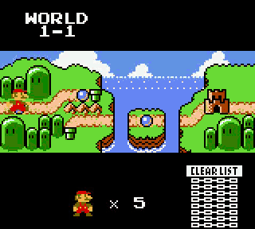
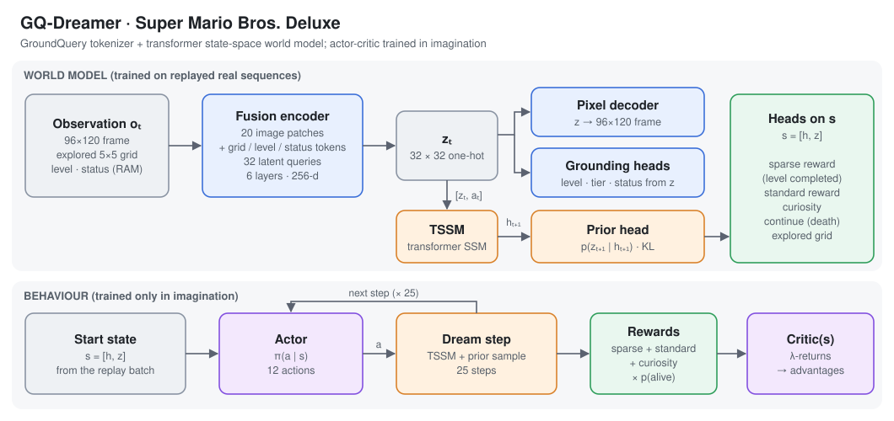
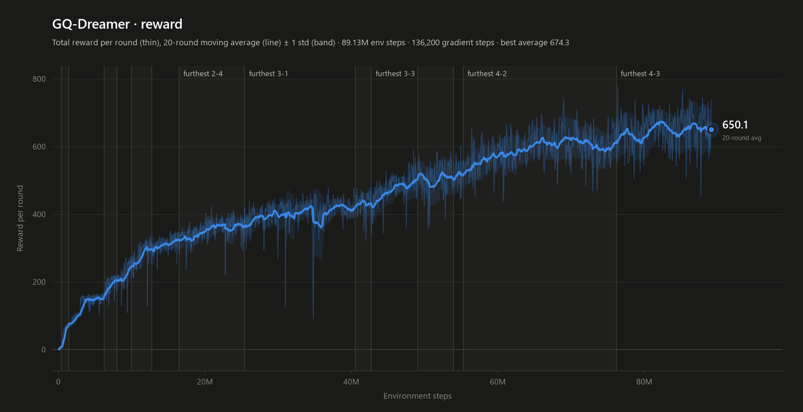
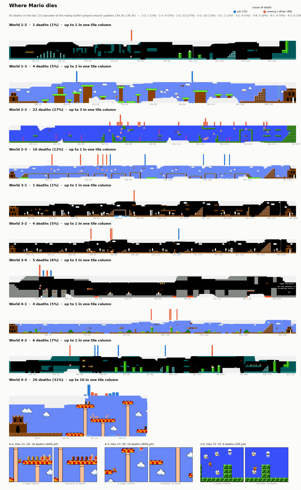

<div align="center">

# GQ-Dreamer · Super Mario Bros. Deluxe

**A model-based reinforcement-learning agent that learns to play Super Mario Bros. Deluxe (Game Boy Color) inside its own learned world model.**



*The final model (`model/model.pt`) clearing World 1-1 (2× speed). In the same episode it goes on to clear 1-2, 1-3
and 1-4. Sampled actions, no human input.*

</div>

---

## Overview

GQ-Dreamer (**GroundQuery-Dreamer**) is a Dreamer-style agent with two changes to the classic recipe:

- **GroundQuery tokenizer.** The encoder is a fusion transformer that reads the screen as patch tokens *together with* a
  few game-state tokens (explored grid, level, power-up status). A set of **32 learned latent queries** reads the fused
  tokens and outputs one 32-class categorical each, so the latent `z` is a 32 × 32 one-hot code. The decoder and the
  grounding heads read `z` only, so everything the agent needs about the frame has to be stored in `z`.
- **Transformer state-space model (TSSM).** The recurrent model is a causal transformer with RoPE, gated attention, an
  attention sink and a KV ring cache. Dreams and acting run as captured CUDA graphs.

The policy never trains on real experience directly: it is trained on **imagined rollouts** ("dreams") of the world
model, which start from states sampled out of the replay buffer.

<p align="center"></p>

## Results

Trained for **136,300 gradient steps / 89.3 M environment steps** (34,150 episodes, 25 emulators in parallel) on a
single GPU.

<p align="center"></p>

| | |
|---|---|
| Model size | ~63 M parameters |
| Episode reward at the end of training (20-round average) | **≈ 650** (best episode 881) |
| Furthest level reached | **World 4-3** |
| Hardest levels at the end of training | 2-2 (underwater) and 4-3 (mushroom platforms) |

The vertical lines mark the first time an episode reached a new level. The map below shows where the agent still dies
near the end of training: the underwater level 2-2 and the mushroom platforms of 4-3 are the main obstacles.

<details>
<summary><b>Where Mario dies</b> (last 115 episodes of training)</summary>
<p align="center"></p>
</details>

## How it works

**Observation.** Every agent step lasts 8 emulator frames (~133 ms). The agent sees a 96 × 120 frame (HUD removed),
the 5 × 5 grid of tiles around Mario that it already visited in this episode, and a few RAM values (current level,
power-up tier). There are 12 actions (button combinations).

**World model.** For every replayed sequence:

1. The fusion encoder turns each frame into `z_t` (20 image patches + side tokens → 32 latent queries → 32 × 32 one-hot).
2. The pixel decoder reconstructs the frame from `z_t` only; grounding heads predict level and status from `z_t`.
3. The TSSM reads `[z_t, a_t]` and outputs `h_{t+1}`; the prior head predicts `p(z_{t+1} | h_{t+1})`, trained with a
   balanced KL against the posterior (free nats, dyn : rep = 10 : 1).
4. Heads on `s = [h, z]` predict the sparse reward (level completed, +50), the standard reward (coins, power-ups),
   curiosity, the explored grid and whether Mario survives the next step.

**Behaviour.** Dreams start from replay states (part of them a few steps before a death, part of them at the most
surprising states) and run 25 steps in the world model. The actor is trained with REINFORCE on per-stream normalised
advantages of the extrinsic and curiosity rewards; the critics use HL-Gauss value targets with EMA target networks.

**Rewards.** +50 for each level completed, +10 per power-up tier, +1 per coin, and a curiosity bonus for every new tile
(more for tiles entered moving right). The episode ends at a death or when the step budget (extended after each
completed level) runs out.

## Quick start

### 1. Install

```bash
git clone https://github.com/SeleucusTheGreat/GQ-Dreamer-SMB.git
cd GQ-Dreamer-SMB
git lfs install && git lfs pull        # downloads model/model.pt (≈ 280 MB)

conda create -n gqdreamer python=3.11 && conda activate gqdreamer
pip install torch --index-url https://download.pytorch.org/whl/cu124   # CUDA build (CPU works for playing)
pip install -r requirements.txt
```

### 2. Add the game

The ROM is not included. Copy your own dump of **Super Mario Bros. Deluxe** to `game/SuperMarioBrosDeluxe.gbc`.
The start state `game/SMBDeluxe.Start.state` is included.

### 3. Watch the trained agent

Open **`run.ipynb`** and run the cell: the model in `model/model.pt` plays in an emulator window. Or from Python:

```python
from gq_dreamer import run
run(mode="eval", checkpoint="model/model.pt", num_eval_envs=1, num_eval_episodes=1, recording=True)
```

`recording=True` also saves `recordings/eval_agent1.mp4`; `window=False` runs headless.

### 4. Train

Open **`main.ipynb`**, or:

```python
from gq_dreamer import run
run(mode="train", num_envs=25)
```

Training resumes from the newest checkpoint in `checkpoints/` and writes metrics to `metrics/training_data.csv` and
plots to `plots/`. Every hyperparameter is a field of `GQDreamerConfig` in `gq_dreamer/config.py` and can be
overridden: `run(..., dream_horizon=20)`. Training needs a CUDA GPU; with less GPU memory or fewer CPU cores, lower
`batch_size` and `num_envs`.

## Repository layout

```
gq_dreamer/
  model.py          every network: latents, heads, actor / critic, tokenizer, TSSM, prior
  gq_dreamer.py     the agent: world-model update, imagination, acting, dream audit
  env.py            PyBoy environment, rewards, parallel emulators
  game.py           game constants: actions, levels, RAM addresses, curiosity tables
  observations.py   frame processing, patches, sprite masks
  replay.py         replay buffer and batch prefetcher
  trainer.py        training loop, evaluation, metrics, run()
  config.py         GQDreamerConfig: all hyperparameters
  audit.py          dream audit (dreamed vs real rollouts)
  checkpoint.py     saving / loading
  plots.py, visualize.py, dream_render.py, death_maps.py, train_utils.py
model/model.pt      the trained agent (Git LFS)
game/               start state (add the ROM here)
metrics/            training curves (CSV)
main.ipynb          training
run.ipynb           play the trained model
```

## Acknowledgements

GQ-Dreamer builds on [DreamerV3](https://arxiv.org/abs/2301.04104) (Hafner et al.), transformer world models such as
[TWM](https://arxiv.org/abs/2303.07109) and [STORM](https://arxiv.org/abs/2310.09615), HL-Gauss value targets
([Farebrother et al., 2024](https://arxiv.org/abs/2403.03950)) and the [PyBoy](https://github.com/Baekalfen/PyBoy)
emulator. Super Mario Bros. Deluxe is © Nintendo; this repository contains no game data.
